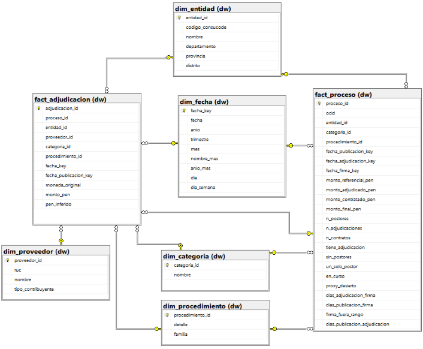

# Contrataciones Públicas del Perú 2023–2025 · SQL Server + Power BI

Análisis de la contratación pública peruana con datos abiertos del OECE (estándar OCDS): pipeline ETL en **SQL Server** (stg → core → dw en estrella) y dashboard de 5 páginas en **Power BI**.


[Ver dashboard completo (PDF)](imagenes/dashboard-completo.pdf)

## Objetivo

Construir de punta a punta un caso de BI con datos reales y desordenados: ingesta masiva, limpieza, modelado dimensional, validación de métricas, rendimiento (índices), respaldo/restauración y visualización.

## Dashboard

**Gasto**


**Proveedores**


**Competencia**


**Notas**


## Fuente de datos

- **OECE – Contrataciones Abiertas (OCDS)**, CSV por año (2023, 2024, 2025). Licencia [CC BY 4.0](https://creativecommons.org/licenses/by/4.0/deed.es).
- Descarga: [Portal de Contrataciones Abiertas OCDS](https://www.gob.pe/52005-acceder-al-portal-de-contrataciones-abiertas-de-la-compra-publica-ocds) · [Portal de Datos Abiertos del OECE](https://www.gob.pe/14272-acceder-al-portal-de-datos-abiertos-del-oece)
- Los datos **no se incluyen** en el repositorio. Este proyecto es independiente y no está afiliado ni respaldado por el OECE.

## Arquitectura

```
CSV OCDS (9 archivos/año) ──BULK INSERT──▶ stg (NVARCHAR(MAX))
                                           │  etl.sp_cargar_staging
                                           ▼
                                      core (normalizado, deduplicado por ocid)
                                           │  etl.sp_construir_modelo (1 transacción + conciliación)
                                           ▼
                                      dw (estrella) ──▶ Power BI (Import)
```

Modelo dimensional: ver [docs/modelo_datos.md](docs/modelo_datos.md).



## Estructura del repositorio

```
sql/            Scripts numerados (ejecutar en orden)
  01_crear_bd.sql                 BD, esquemas y tablas
  02_pipeline_etl.sql             Procedimientos del ETL (staging, modelo, orquestador)
  03_validacion_metricas.sql      Validación y línea base (etl.baseline)
  04_consultas_analiticas.sql     Consultas Q1–Q8
  05_indices_antes_despues.sql    Índices y comparación de rendimiento
  06_respaldo_restauracion.sql    BACKUP / RESTORE
  exploracion/perfilado_calidad.sql
powerbi/        Dashboard, tema, medidas DAX (ver powerbi/README.md)
docs/           Metodología, hallazgos, diccionario, modelo, rendimiento
imagenes/       Capturas del dashboard, modelo estrella y PDF
```

## Cómo reproducirlo

1. Descargar los CSV y organizarlos en una carpeta por año, con **estos 9 archivos en cada una** (los nombres deben coincidir exactamente):

   ```
   C:\datos_oece\
   ├── 2023\
   ├── 2024\
   └── 2025\
         ├── main.csv
         ├── parties.csv
         ├── tender_tenderers.csv
         ├── tender_items.csv
         ├── awards.csv
         ├── awards_suppliers.csv
         ├── awards_value_exchangeRates.csv
         ├── contracts.csv
         └── contracts_value_exchangeRates.csv
   ```

   La carpeta base es el parámetro `@carpeta` (por defecto `C:\datos_oece\`); si usas otra ruta, pásala al ejecutar el pipeline: `EXEC etl.sp_ejecutar_pipeline @carpeta = N'D:\mis_datos\';`. El servicio de SQL Server debe tener permiso de lectura sobre esa carpeta. El pipeline valida las columnas de cada archivo y falla con un mensaje claro si falta alguna.

2. Ejecutar `sql/01_crear_bd.sql`, luego `sql/02_pipeline_etl.sql` (crea los procedimientos).
3. Ejecutar el pipeline completo:
   ```sql
   -- Primera vez / carga completa: staging (BULK INSERT) + core + dw, años 2023-2025
   EXEC etl.sp_ejecutar_pipeline;
   -- Solo algunos años:
   EXEC etl.sp_ejecutar_pipeline @anios=N'2024,2025', @desde='2024-01-01';
   -- Staging ya cargado y solo cambió la lógica de core/dw (no vuelve a leer los CSV):
   EXEC etl.sp_ejecutar_pipeline @omitir_staging=1;
   ```
4. Validar con `03_validacion_metricas.sql`; opcional `05` y `06`.
5. Abrir el `.pbix` y actualizar el origen (servidor/BD) en _Transformar datos_.

> El modelo dw incluye claves foráneas (se crean dentro del pipeline), por lo que SSMS dibuja las relaciones en un diagrama de base de datos.

> Si ejecutas el pipeline sobre una BD creada con una versión anterior del esquema, puede aparecer el error 207 (columna inexistente); en una BD nueva creada con `01` no ocurre.

## Decisiones de diseño

- **Gasto = monto adjudicado.** Nunca se suma uniendo contratos con adjudicaciones (duplicaría montos).
- **Una versión por `ocid`:** la de `date` más reciente.
- **Cohorte por año de publicación** en todas las páginas, para que "año" signifique lo mismo en todas.
- **2025 está incompleto** (corte `en_curso` 2025-10-01); las comparaciones usan **ene–jun** (like-for-like).
- **Desierto** es una _proxy_ (proceso competitivo sin adjudicación y no en curso), no un estado oficial.
- **Un solo postor** solo se mide en familias competitivas.
- **Ahorro** solo en procesos con monto referencial y adjudicado.
- Proveedores: nombres normalizados (mayúsculas, sin comillas); RUC genérico `99999999999` identificado y tratado aparte.

## Hallazgos principales

| Indicador                | Valor                               |
| ------------------------ | ----------------------------------- |
| Gasto adjudicado total   | S/ 142.8 mil M                      |
| Procesos                 | 196,277 (76.8% adjudicados)         |
| Ahorro vs. referencial   | 4.7%                                |
| Entidades                | 2,977 · Top 10 concentran 26.4%     |
| Lima                     | 51.3% del gasto                     |
| Proveedores adjudicados  | 70,771 · Top 10 = 5.2% · líder 0.8% |
| Postores promedio        | 15.0 · un solo postor 1.4%          |
| Desiertos (proxy)        | 24.7%                               |
| Mediana días a adjudicar | 15                                  |

Detalle y matices en [docs/hallazgos.md](docs/hallazgos.md).

## Limitaciones

Ver [docs/metodologia.md](docs/metodologia.md): 2025 parcial, proxy de desierto, calidad de nombres/RUC en origen, cambio de régimen (Ley 32069) sin inferencia causal.

## Tecnologías

SQL Server (T-SQL, BULK INSERT, procedimientos, índices, backup/restore) · Power BI (DAX, modelado, visuales) · OCDS.

## Autor

Jeremmy Kheyler Pretel Pretel · Ingeniería de Sistemas, UNMSM · https://www.linkedin.com/in/jeremmy-pretel/

## Licencia

Código y documentación: [MIT](LICENSE). Datos: OECE, CC BY 4.0.
