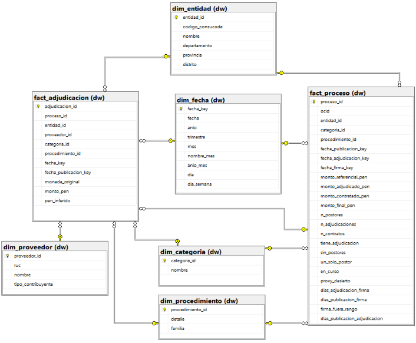

# Modelo de datos (esquema dw)

- **Hechos**: `fact_proceso` (1 fila por proceso) y `fact_adjudicacion` (1 fila por adjudicación).
- **Dimensiones**: `dim_fecha`, `dim_entidad`, `dim_proveedor`, `dim_procedimiento`, `dim_categoria`.
- En Power BI la relación activa con `dim_fecha` es la de **publicación**; adjudicación y firma se usan con `USERELATIONSHIP`.
- Capas previas: `stg` (crudo), `core` (normalizado), `etl` (log, métricas, línea base, procedimientos).
- Fuente editable del diagrama: [modelo_estrella.mmd](modelo_estrella.mmd) (Mermaid).
